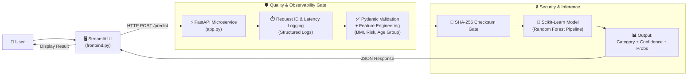

# 🛡️ Insurance Premium Prediction REST API

An end-to-end Machine Learning web application and production-grade microservice that predicts an applicant's **Insurance Premium Category** (`Low`, `Medium`, or `High`) based on their health indicators, lifestyle habits, and demographic details.

[](https://www.python.org/)
[](https://fastapi.tiangolo.com/)
[](https://scikit-learn.org/)
[](https://www.docker.com/)
[](.github/workflows/ci.yml)
[](MODEL_CARD.md)

---

## 🧭 How It Works (Workflow Architecture)



---

## 🔍 Core Components & AI Quality Features

### 1. 🧠 Machine Learning Model & Governance
* **Algorithm**: `RandomForestClassifier` inside an Scikit-Learn `Pipeline` with `ColumnTransformer`.
* **Target Classes**: Predicts premium risk category — `Low`, `Medium`, or `High`.
* **Deterministic Feature Engineering**: Automatic transformations via Pydantic (`schema/user_input.py`):
  - **BMI**: $\frac{\text{weight}}{\text{height}^2}$
  - **Lifestyle Risk**: Evaluated from BMI and smoking status (`high`, `medium`, `low`).
  - **Age Group**: Categorized into `young`, `adult`, `middle_aged`, or `senior`.
  - **City Tier**: Normalized and resolved from database into Tier 1, 2, or 3.
* **Model Card**: See [MODEL_CARD.md](MODEL_CARD.md) for ethical considerations, data constraints, and performance evaluation.

---

### 2. ⚡ FastAPI Backend & Observability
* **Asynchronous High Performance**: Built with FastAPI and `uvicorn`.
* **Distributed Tracing & Request IDs**: Every request is assigned a unique `X-Request-ID` and timestamped with `X-Process-Time-Ms` response headers.
* **Structured Logging**: Transactions are logged with method, path, status, latency, and prediction metrics for operational auditing.
* **Render-Ready Health Checks**: Dual `GET` and `HEAD` support on `/` and `/health` for zero-downtime platform health probes.
* **Interactive Documentation**:
  - Swagger UI: `http://localhost:8000/docs`
  - ReDoc: `http://localhost:8000/redoc`

---

### 3. 🔒 Model Security & Integrity
* **Cryptographic Tamper-Proofing**: Before deserializing `model.pkl`, the system validates the file against a recorded **SHA-256 cryptographic checksum** (`ML_model/model.sha256`), preventing pickle deserialization injection vulnerabilities.

---

### 4. 🧪 Automated Testing & CI/CD Quality Gates
* **32 Automated Tests** covering:
  - **API Contract Tests** (`tests/test_api.py`): Verifies HTTP codes, headers, and schemas.
  - **Model Invariance & Sensitivity Tests** (`tests/test_model.py`): Directional testing confirming risk score sensitivities.
  - **Schema Boundary Tests** (`tests/test_schema.py`): Edge-case testing on heights, weights, age limits, and city normalization.
* **GitHub Actions CI** (`.github/workflows/ci.yml`): Runs automated quality checks and test suites on every pull request and push to `main`.

---

## 📁 Project Structure

```plaintext
Insurance_Premium_prediction/
├── .github/workflows/
│   └── ci.yml                 # Automated CI/CD Quality Gate
├── app.py                     # FastAPI backend with observability middleware
├── frontend.py                # Streamlit web UI
├── Dockerfile                 # Slim, production-ready container image
├── requirements.txt           # Production dependencies
├── pyproject.toml             # Project metadata and test configuration
├── MODEL_CARD.md              # AI Model Card (Mitchell et al. standard)
│
├── ML_model/
│   ├── model.pkl              # Trained Random Forest pipeline artifact
│   ├── model.sha256           # SHA-256 cryptographic checksum
│   └── predict.py             # Model verification and inference
│
├── schema/
│   ├── user_input.py          # Input validation & feature engineering
│   └── prediction_response.py # Output schema contract
│
├── config/
│   └── city_tier.py           # City categorization lists
│
└── tests/
    ├── test_api.py            # API integration & health tests
    ├── test_model.py          # AI model quality & directional tests
    └── test_schema.py         # Schema boundary and feature tests
```

---

## 🚀 Running the Project

### Running Automated Tests
```bash
pytest -v tests/
```

### Running with Docker (Recommended)
1. **Build the container:**
   ```bash
   docker build -t insurance-api .
   ```
2. **Run the container:**
   ```bash
   docker run -p 8000:8000 --name insurance-container insurance-api
   ```
3. Open `http://localhost:8000/docs` in your browser.

### Running Locally
1. **Install dependencies:**
   ```bash
   pip install -r requirements.txt
   ```
2. **Start the FastAPI backend:**
   ```bash
   uvicorn app:app --reload --port 8000
   ```
3. **In a separate terminal, launch the Streamlit frontend:**
   ```bash
   streamlit run frontend.py
   ```

---

## 👤 Author
* **Author**: Arjit Katiyar
